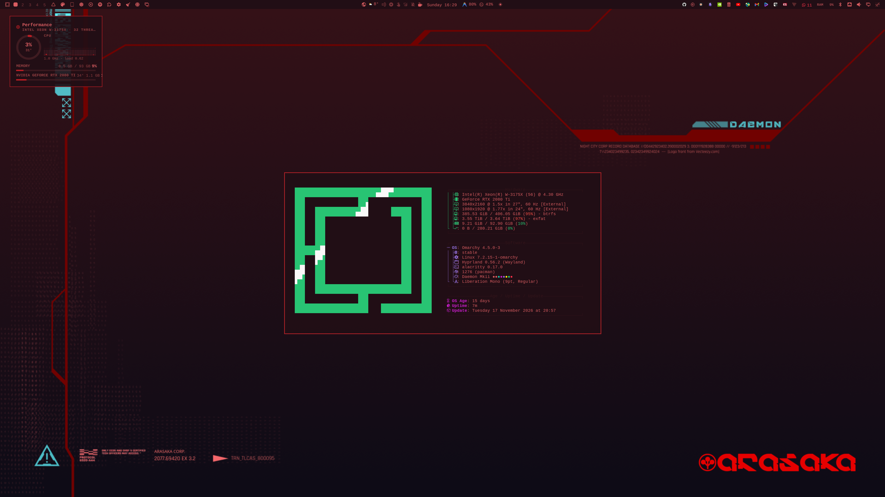
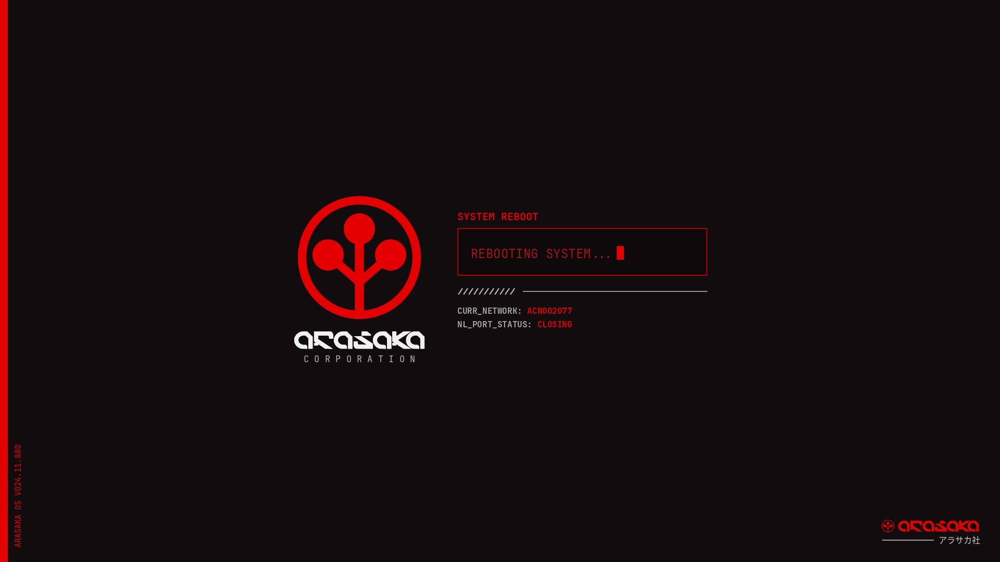
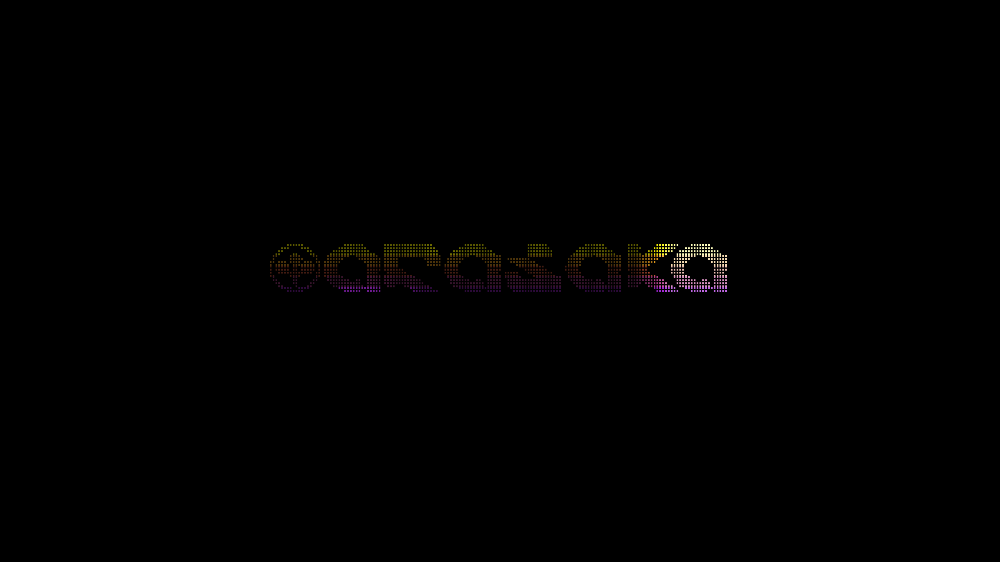

# Arasaka Corp — Omarchy Theme Bundle

A Cyberpunk 2077 Arasaka Corporation-themed complete desktop bundle for [Omarchy](https://omarchy.org/).

> **Fork Notice:** This repository is a fork of [Doghouse-Mike/omarchy-daemon-mkii-theme](https://github.com/Doghouse-Mike/omarchy-daemon-mkii-theme) (which itself is adapted from the [Daemon 2.0 KDE Plasma theme](https://github.com/MathisP75/daemon-kde-mk2) by [MathisP75](https://github.com/MathisP75)). It preserves the upstream base while replacing the accent/foreground palette with Arasaka crimson/red, adding an Arasaka wallpaper, and bundling the Arasaka Terminal Plymouth bootsplash & reset/shutdown screens plus the Omarchy terminal screensaver.

## What Will Be Installed

Running the bundled installer installs up to three components (or you can install each part individually):

1. **Omarchy Theme (`arasaka-corp`)** — installed to `~/.config/omarchy/themes/arasaka-corp/` and applied via `omarchy theme set arasaka-corp`:
   - `colors.toml` — Arasaka crimson (`#B81D24`) accent, `#D85C60` foreground, `#210E15` / `#14101F` / `#040A10` dark backgrounds
   - `icons.theme` — `Omarchroma-Icons`
   - `backgrounds/` — `00-arasaka-1920x1080.png` (default Arasaka wallpaper) plus the original Daemon MKII wallpapers
2. **Plymouth Bootsplash & Reset/Shutdown Screen (`arasaka-terminal`)** — installed to `/usr/share/plymouth/themes/arasaka-terminal/` and set as default (`plymouth-set-default-theme -R arasaka-terminal` + `limine-mkinitcpio` if present):
   - **Boot / LUKS Unlock**: `SECURITY LOGIN` prompt with `UID_` prefix, masked password bullets, glitch intro, and `ACCESS GRANTED // BOOTING` transition
   - **Reset / Reboot**: `SYSTEM REBOOT` with `REBOOTING SYSTEM...` status
   - **Shutdown**: `SYSTEM SHUTDOWN` with `SHUTTING DOWN...` status
3. **Terminal Screensaver (`screensaver.txt`)** — installed to `~/.config/omarchy/branding/screensaver.txt` (backing up any existing file first) for `omarchy screensaver` / `omarchy launch screensaver`.

## Screenshots

### Clean Workspace


### About System (Full Desktop Visible)


### Bootsplash Screen (`SECURITY LOGIN`)


### Reset / Reboot Screen (`SYSTEM REBOOT`)


### Screensaver


## Installation

Clone the repository:

```bash
git clone https://github.com/Xkalin1990/omarchy-arasaka-corp-theme.git
cd omarchy-arasaka-corp-theme
```

### Option 1: Install the Full Bundle

```bash
./install.sh
```

You can also pass flags to `./install.sh` to select specific parts:

```bash
./install.sh --theme        # Theme (colors, icons, wallpaper) only
./install.sh --plymouth     # Plymouth bootsplash & reset screen only
./install.sh --screensaver  # Terminal screensaver only
```

### Option 2: Install Individual Components Separately

```bash
./scripts/install-theme.sh        # Installs ~/.config/omarchy/themes/arasaka-corp and applies it
./scripts/install-plymouth.sh     # Installs /usr/share/plymouth/themes/arasaka-terminal (requires sudo)
./scripts/install-screensaver.sh  # Installs ~/.config/omarchy/branding/screensaver.txt
```

### Option 3: Theme Only via `omarchy theme install`

If you only want the Omarchy colors, icons, and wallpapers without the Plymouth theme or screensaver:

```bash
omarchy theme install https://github.com/Xkalin1990/omarchy-arasaka-corp-theme
```

## Color Palette

| Name             | Hex       |
|------------------|-----------|
| Accent           | `#B81D24` |
| Selection        | `#5A1A22` |
| Foreground       | `#D85C60` |
| Background       | `#210E15` |
| Dark Background  | `#14101F` |
| Red              | `#FB3048` |
| Green            | `#28C775` |
| Yellow           | `#FDF500` |
| Blue             | `#9370DB` |
| Magenta          | `#CB1DCD` |
| Cyan             | `#1AC5B0` |

## Credits

- **Original Omarchy Theme**: [Doghouse-Mike/omarchy-daemon-mkii-theme](https://github.com/Doghouse-Mike/omarchy-daemon-mkii-theme)
- **Original KDE Plasma Theme**: [MathisP75/daemon-kde-mk2](https://github.com/MathisP75/daemon-kde-mk2) by [MathisP75](https://github.com/MathisP75)
- **Arasaka Terminal Plymouth & Bundle**: [Xkalin1990](https://github.com/Xkalin1990)

## License

[GPL-3.0](LICENSE) — same as the upstream Daemon MKII theme.
