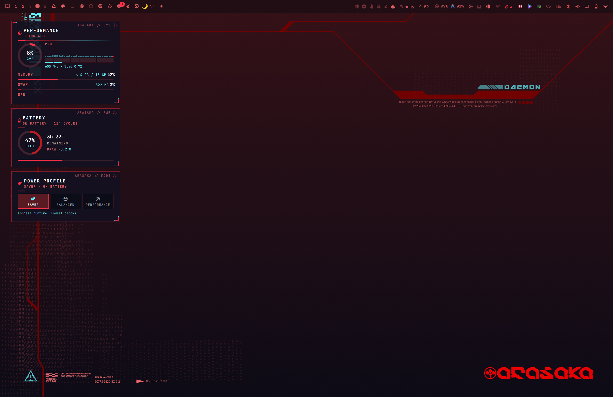
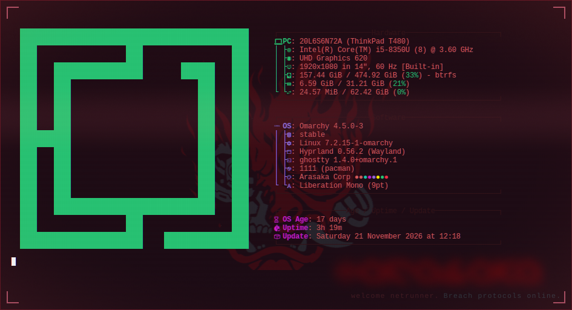

# Arasaka Corp — Omarchy Theme Bundle

A Cyberpunk 2077 Arasaka Corporation-themed complete desktop bundle for [Omarchy](https://omarchy.org/).

> **Fork Notice:** This repository is a fork of [Doghouse-Mike/omarchy-daemon-mkii-theme](https://github.com/Doghouse-Mike/omarchy-daemon-mkii-theme) (which itself is adapted from the [Daemon 2.0 KDE Plasma theme](https://github.com/MathisP75/daemon-kde-mk2) by [MathisP75](https://github.com/MathisP75)). It preserves the upstream base while replacing the accent/foreground palette with Arasaka crimson/red, adding an Arasaka wallpaper, and bundling the Arasaka Terminal Plymouth bootsplash & reset/shutdown screens, the Omarchy terminal screensaver, and the Ghostty terminal theme & CRT HUD shader.

## What Will Be Installed

Running the bundled installer installs up to six components (or you can install each part individually):

1. **Omarchy Theme (`arasaka-corp`)** — installed to `~/.config/omarchy/themes/arasaka-corp/` and applied via `omarchy theme set arasaka-corp`:
   - `colors.toml` — Arasaka crimson (`#B81D24`) accent, `#D85C60` foreground, `#210E15` / `#14101F` / `#040A10` dark backgrounds
   - `icons.theme` — `Omarchroma-Icons`
   - `backgrounds/` — `00-arasaka-1920x1080.png` (default Arasaka wallpaper) plus the original Daemon MKII wallpapers (cycle with `omarchy theme bg next`)
2. **Plymouth Bootsplash & Reset/Shutdown Screen (`arasaka-terminal`)** — installed to `/usr/share/plymouth/themes/arasaka-terminal/` and set as default (`plymouth-set-default-theme -R arasaka-terminal` + `limine-mkinitcpio` if present):
   - **Boot / LUKS Unlock**: `SECURITY LOGIN` prompt with `UID_` prefix, masked password bullets, glitch intro, and `ACCESS GRANTED // BOOTING` transition
   - **Reset / Reboot**: `SYSTEM REBOOT` with `REBOOTING SYSTEM...` status
   - **Shutdown**: `SYSTEM SHUTDOWN` with `SHUTTING DOWN...` status
3. **Terminal Screensaver (`screensaver.txt`)** — installed to `~/.config/omarchy/branding/screensaver.txt` (backing up any existing file first) for `omarchy launch screensaver force`.
4. **Ghostty Terminal Theme (`ghostty`)** — installed to `~/.config/ghostty/` (backing up any existing `config` first):
   - `config` — Arasaka-Corp Ghostty configuration referencing Omarchy's dynamic theme colors, Samurai watermark, custom shader, and GTK CSS (note: `custom-shader-animation = true` continuously redraws at display refresh rate; set to `false` in `~/.config/ghostty/config` to save battery)
   - `assets/samurai-logo.png` — centered low-opacity Cyberpunk 2077 Samurai oni-mask watermark (plus `arasaka-emblem.{png,svg}` and `netrunner-status.{png,svg}` assets)
   - `shaders/arasaka-hud.glsl` — full-window subtle CRT + crimson HUD corner shader
   - `gtk-arasaka.css` — custom GTK CSS styling window/tab chrome + bottom-right netrunner status
5. **OmaWidgets Desktop Cards (`omawidgets`)** — theme-scoped Arasaka HUD styling for the **[OmaWidgets](https://github.com/fabandrade88/OmaWidgets)** Omarchy shell plugin (`io.github.fabandrade88.omawidgets`), specifically targeting the **Performance** (`system`), **Battery** (`battery`), and **Power profile** (`power`) desktop cards:
   - Sharp `0px` angular HUD frame with `#14101F` backdrop, `#FB3048` borders, SVG corner brackets, gradient header divider, and subtle `ARASAKA // SYS|PWR|MODE` crest tag
   - `JetBrainsMono Nerd Font` uppercase tracked labels and `#FB3048` / `#5DF4FE` crimson-and-cyan telemetry gauges, bars, and tactical power profile buttons
   - **Theme-scoped**: automatically activates only when `arasaka-corp` is the active Omarchy theme and reverts cleanly to standard styling on any other theme
6. **Global CRT Phosphor Glow Shader (`shaders/crt-scanlines.glsl`)** — Hyprland `decoration.screen_shader` installed to `~/.config/hypr/shaders/crt-scanlines.glsl` and wired into `~/.config/hypr/looknfeel.lua`:
   - Two-ring 16-tap amber/crimson phosphor bloom for bright text, UI highlights, and dark crimson/red accents
   - Subtle horizontal CRT scanlines (~12% modulation) and edge vignette
   - To disable later, set `screen_shader = "[[EMPTY]]"` in `~/.config/hypr/looknfeel.lua` or run `./uninstall.sh`

## Prerequisites

- [Omarchy](https://omarchy.org/) (`omarchy` CLI, Hyprland, `JetBrainsMono Nerd Font`)
- `git` and `python3` (for OmaWidgets installation and `shell.json` / config updates)
- `ghostty` and `Liberation Mono` font (for the Ghostty theme)
- `plymouth` and `sudo` (optional, for the Plymouth bootsplash)

## Screenshots

### Clean Workspace


### About System (Full Desktop Visible)


### Bootsplash Screen (`SECURITY LOGIN`)


### Reset / Reboot Screen (`SYSTEM REBOOT`)


### Screensaver


### Ghostty Terminal


## Installation

Clone the repository:

```bash
git clone https://github.com/Xkalin1990/omarchy-arasaka-corp-theme.git
cd omarchy-arasaka-corp-theme
```

### Option 1: Install the Full Bundle

```bash
./install.sh
```

You can also pass flags to `./install.sh` to select specific parts:

```bash
./install.sh --theme        # Theme (colors, icons, wallpaper) only
./install.sh --plymouth     # Plymouth bootsplash & reset/shutdown screen only
./install.sh --screensaver  # Terminal screensaver only
./install.sh --ghostty      # Ghostty terminal theme & CRT HUD shader only
./install.sh --omawidgets   # OmaWidgets Arasaka HUD cards only
./install.sh --shader       # Global Hyprland CRT phosphor glow shader only
```

### Option 2: Install Individual Components Separately

```bash
./scripts/install-theme.sh        # Installs ~/.config/omarchy/themes/arasaka-corp and applies it
./scripts/install-plymouth.sh     # Installs /usr/share/plymouth/themes/arasaka-terminal (requires sudo)
./scripts/install-screensaver.sh  # Installs ~/.config/omarchy/branding/screensaver.txt
./scripts/install-ghostty.sh      # Installs ~/.config/ghostty/ config, assets, shader, and GTK CSS
./scripts/install-omawidgets.sh   # Installs OmaWidgets (if missing) + Arasaka HUD card styling
./scripts/install-shader.sh       # Installs global Hyprland CRT phosphor glow shader
```

### Setting Up OmaWidgets Desktop Cards (1-Step Install)

The desktop cards require the **[OmaWidgets](https://github.com/fabandrade88/OmaWidgets)** plugin (`io.github.fabandrade88.omawidgets`). You can install the plugin, apply the Arasaka HUD styling, enable the **Performance**, **Battery**, and **Power profile** cards in `~/.config/omarchy/shell.json`, and restart the shell with a single command:

```bash
curl -fsSL https://raw.githubusercontent.com/Xkalin1990/omarchy-arasaka-corp-theme/main/scripts/install-omawidgets.sh | bash
```

*(If you already cloned this repo, `./install.sh --omawidgets` or `./scripts/install-omawidgets.sh` does the exact same thing. Your existing `shell.json` is backed up before any edit, and if `io.github.fabandrade88.omawidgets` is already in your `shell.json`, your card layout is left untouched.)*

### Option 3: Theme Only via `omarchy theme install`

If you only want the Omarchy colors, icons, and wallpapers (without Plymouth, screensaver, Ghostty, OmaWidgets, or the global Hyprland shader):

```bash
omarchy theme install https://github.com/Xkalin1990/omarchy-arasaka-corp-theme
```

## Uninstall

```bash
chmod +x uninstall.sh
./uninstall.sh
omarchy theme set <other-theme>
```

## Color Palette

| Name             | Hex       |
|------------------|-----------|
| Accent           | `#B81D24` |
| Selection        | `#5A1A22` |
| Foreground       | `#D85C60` |
| Background       | `#210E15` |
| Dark Background  | `#14101F` |
| Red              | `#FB3048` |
| Green            | `#28C775` |
| Yellow           | `#FDF500` |
| Blue             | `#9370DB` |
| Magenta          | `#CB1DCD` |
| Cyan             | `#1AC5B0` |

## Credits

- **Original Omarchy Theme**: [Doghouse-Mike/omarchy-daemon-mkii-theme](https://github.com/Doghouse-Mike/omarchy-daemon-mkii-theme)
- **Original KDE Plasma Theme**: [MathisP75/daemon-kde-mk2](https://github.com/MathisP75/daemon-kde-mk2) by [MathisP75](https://github.com/MathisP75)
- **Arasaka Terminal Plymouth & Bundle**: [Xkalin1990](https://github.com/Xkalin1990)

## License

[GPL-3.0](LICENSE) — same as the upstream Daemon MKII theme.
